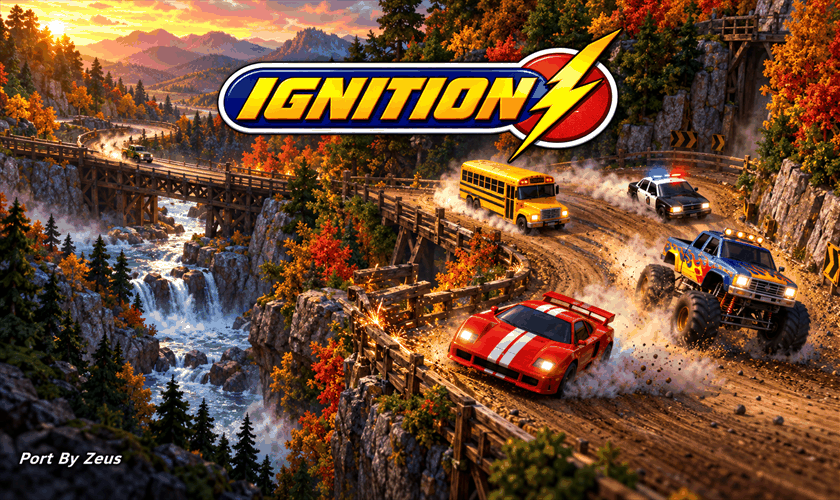
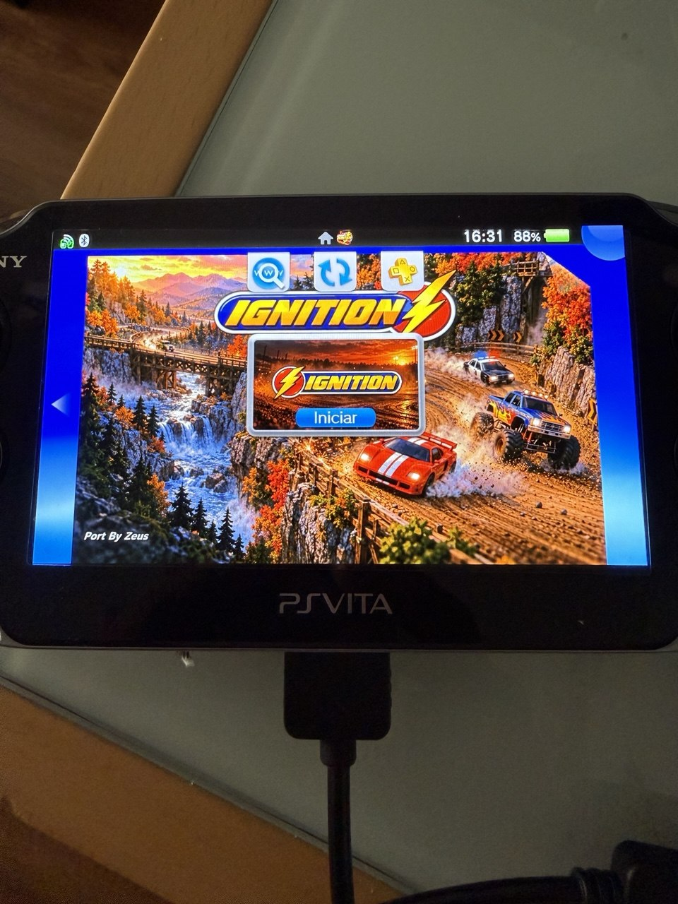

<p align="center">
  
</p>

<h1 align="center">Ignition Vita</h1>

<p align="center">
  <b>Un port del arcade de carreras <i>Ignition</i> (1997) para PlayStation Vita.</b><br>
  Versión <b>v1.0</b> &nbsp;·&nbsp; Plataforma: <b>PlayStation Vita / PlayStation TV</b> (homebrew, modo unsafe) &nbsp;·&nbsp; Port por <b>Zeusthenen (Zeus)</b>
</p>

<p align="center">
  
  
  
  <br>
  <a href="https://github.com/Zeusthenen/Ignition-Vita/releases">Releases</a> &nbsp;·&nbsp;
  <a href="https://github.com/Zeusthenen/Ignition-Vita/issues">Incidencias</a> &nbsp;·&nbsp;
  <a href="docs/INSTALLATION.md">Instalación</a> &nbsp;·&nbsp;
  <a href="docs/FAQ.md">FAQ</a>
</p>

<p align="center">
  <br>
  <sub>El LiveArea del port terminado, fotografiado en una PS Vita real.</sub>
</p>

> **Aviso legal.** Ignition Vita es un port de aficionados, no oficial y sin fines comerciales. No está afiliado ni respaldado por Interplay, UDS ni por ningún titular actual de los derechos. Ignition, su nombre, logotipo y los recursos originales del juego pertenecen a sus respectivos propietarios. Los archivos originales del juego no se incluyen y deben ser aportados legalmente por el usuario. Este aviso no constituye una concesión de derechos sobre el logotipo ni sobre los recursos originales.
>
> **Legal notice.** Ignition Vita is an unofficial, non-commercial fan port. It is not affiliated with or endorsed by Interplay, UDS, or any current rights holder. Ignition, its name, logo and original game assets belong to their respective owners. Original game files are not included and must be supplied legally by the user. This notice does not grant any right over the logo or the original resources.
>
> **Este repositorio y el VPK publicado no contienen ningún dato del juego**: ni ejecutable, ni recursos, música, vídeos, pistas, modelos ni otros archivos del juego comercial. Debes aportar tus propios archivos, procedentes de tu propia copia legal de *Ignition* (ver [Datos originales necesarios](#7-datos-originales-necesarios)). El proyecto tampoco está afiliado ni respaldado por Sony.

[Read in English → README.md](README.md)

---

## Contenido

1. [Acerca del proyecto](#1-acerca-del-proyecto)
2. [Características](#2-características)
3. [Estado actual](#3-estado-actual)
4. [Rendimiento](#4-rendimiento)
5. [Requisitos](#5-requisitos)
6. [Instalación](#6-instalación)
7. [Datos originales necesarios](#7-datos-originales-necesarios)
8. [Controles](#8-controles)
9. [Configuración](#9-configuración)
10. [Guardado y registros](#10-guardado-y-registros)
11. [Funciones desactivadas y limitaciones conocidas](#11-funciones-desactivadas-y-limitaciones-conocidas)
12. [Compilar desde el código fuente](#12-compilar-desde-el-código-fuente)
13. [Solución de problemas](#13-solución-de-problemas)
14. [Informar de errores](#14-informar-de-errores)
15. [Créditos](#15-créditos)
16. [Licencias](#16-licencias)
17. [Capturas](#17-capturas)
18. [Historial de versiones](#18-historial-de-versiones)

---

## 1. Acerca del proyecto

*Ignition* (1997) es un juego de carreras arcade para PC. Ignition Vita permite jugar al **juego original de Windows** en una PlayStation Vita.

**No** es una reescritura ni un remake. El port carga el ejecutable original `Ign_3dfx.exe` (la versión 3dfx/Glide), ejecuta su código x86 en la Vita mediante un recompilador dinámico (x86 → ARMv7) y proporciona en código nativo de Vita todo lo que el ejecutable espera de Windows: archivos, temporizadores, DirectInput, DirectSound, el bucle de mensajes, el audio de CD (MCI) y la API 3D Glide (traducida a llamadas OpenGL sobre la GPU de la Vita con [vitaGL](https://github.com/Rinnegatamante/vitaGL)).

Por eso necesita los archivos de datos del propio juego, que **no** se incluyen. Más detalles en [docs/TECHNICAL_NOTES.md](docs/TECHNICAL_NOTES.md) (en inglés) y la historia del port en [docs/PORT_HISTORY.md](docs/PORT_HISTORY.md).

## 2. Características

- Ejecuta el ejecutable y los datos originales: modos individuales y campeonato, pistas, coches, menús y opciones del juego de PC.
- Render 3D con vitaGL; el HUD 2D, los menús y los efectos del renderizador por software original se componen correctamente.
- **HUD, transparencias y humo corregidos** (tratamiento de la clave cromática de las texturas originales).
- **Audio completo**: música (las pistas del CD, reproducidas desde tus propios archivos Ogg), motores, turbo, derrapes, choques y todos los efectos.
- **Controles de Vita**: cruceta / joystick izquierdo, botones frontales y gatillos mapeados a los comandos de teclado que el juego espera (ver [Controles](#8-controles)).
- **Selector de idiomas funcional**, con el idioma elegido recordado entre ejecuciones.
- **Selección de coches corregida.**
- **Teclado oficial de Vita** para cambiar el nombre del jugador de tres caracteres.
- **Los datos y opciones se guardan** con la propia rutina de guardado del juego en `ux0:data/ignition/`.
- **Salida limpia** al LiveArea (opción "Salir" del menú del juego).
- **LiveArea personalizado**: icono de burbuja, fondo e imagen de arranque.
- **Limitador de 30 FPS** configurable, para un ritmo de fotogramas uniforme.
- **Perfil automático de frecuencias**: al arrancar el port pide al sistema al menos ARM 444 MHz / BUS 222 MHz / GPU 222 MHz / GPU Xbar 166 MHz (ver [Rendimiento](#4-rendimiento)).

## 3. Estado actual

**v1.0 — primera versión pública.** El ciclo completo del juego (menús → selección de coche → carrera → resultados → menús → salir) se ha jugado en una PS Vita real: carreras normales, de campeonato y la pista Yodel Peaks, con sonido, HUD, humo, selector de idioma, entrada de nombre, guardado y salida limpia.

Dos entradas del menú están desactivadas a propósito: [pantalla dividida y multijugador online](#11-funciones-desactivadas-y-limitaciones-conocidas).

## 4. Rendimiento

En carrera lo habitual son **unos 25–30 fotogramas por segundo**. El port incluye un limitador que presenta como máximo 30 fotogramas por segundo, repartidos uniformemente; es un tope, no una promesa.

Expectativas honestas:

- El rendimiento **varía según la pista, el modo de juego, el número de vehículos y la escena, y según las frecuencias de reloj en uso**. Es fluido en la mayoría de situaciones, pero **no son 30 FPS bloqueados ni constantes**: las escenas cargadas bajan de 30 (en la prueba final del autor en una PS Vita real, las escenas de carrera rondaban 25–27 FPS de media; las más ligeras pueden alcanzar el tope de 30).
- La lógica del juego va por tiempo real: menos FPS hace la imagen menos suave, pero **no** hace más lentos los coches, los temporizadores ni los tiempos de vuelta.
- Por defecto el port solicita las frecuencias de abajo al arrancar.
- Si ya usas **500 MHz mediante un plugin externo**, el port respeta esa configuración y no la reduce. Usar ese plugin es **opcional, decisión y responsabilidad tuya** (más calor y más consumo de batería); el port nunca pide 500 MHz por sí mismo.

**Perfil de frecuencias** (un *mínimo*, aplicado una vez al arrancar, por componente solo si el valor actual es menor):

| Componente | Frecuencia solicitada |
|---|---|
| ARM / CPU | 444 MHz |
| BUS | 222 MHz |
| GPU | 222 MHz |
| GPU Xbar | 166 MHz |

- Se aplica al arrancar el juego, antes de inicializar los gráficos.
- Nunca reduce una frecuencia superior ya establecida por otro (por ejemplo un plugin a 500 MHz).
- Al salir, el port restaura solo las frecuencias que él cambió y solo si nadie las ha cambiado después.
- Un plugin externo puede seguir cambiando las frecuencias tras el arranque; el port no lucha contra él (nunca reaplica el perfil).
- El resultado queda en el registro (`[G160-CLOCKS]` al arrancar, `[G160-CLOCKS-RESTORE]` al salir).

## 5. Requisitos

- Una PlayStation Vita (o PlayStation TV) con firmware personalizado que permita homebrew, con el **homebrew unsafe activado** (el port necesita memoria ejecutable para su recompilador, por eso se instala como aplicación *unsafe*).
- Unos **110 MB** libres para los datos del juego (unos 37 MB de datos más unos 70 MB de música si la aportas; el tamaño depende de cómo la codifiques) y un par de MB para el VPK.
- Un instalador de VPK como VitaShell.
- Tu **propia copia legal de Ignition** de la que tomar los datos (ver [más abajo](#7-datos-originales-necesarios)).

> **No comprobado:** si `libshacccg.suprx` (el módulo compilador de shaders de la Vita) es necesario. El port usa el pipeline de función fija de vitaGL y no compila shaders propios, pero está enlazado con vitaGL/vitaShaRK, que pueden usar ese módulo, y el juego no se ha ejecutado en una consola que carezca de él. Si el juego no arranca y no lo tienes instalado, instálalo según la documentación de vitaGL e informa del resultado.

**PlayStation TV: sin probar.** El port se probó solo en una PS Vita real. El código lee la entrada estándar del mando, así que podría funcionar en una PS TV con un mando emparejado, pero no está confirmado.

## 6. Instalación

Guía completa paso a paso (en inglés): [docs/INSTALLATION.md](docs/INSTALLATION.md). Versión corta:

1. Instala `IgnitionVita_v1.0.vpk` con VitaShell (aparece la burbuja *Ignition Vita* en el LiveArea).
2. Copia los datos de tu propio *Ignition* a `ux0:data/ignition/` ([lista exacta](#7-datos-originales-necesarios)).
3. Inicia el juego. La primera ejecución crea `ux0:data/ignition/logs/`; revisa `ignitionvita.log`.

Actualizar a una versión futura: instala el nuevo VPK sobre el anterior; **no borres `ux0:data/ignition/`** (ahí están tus datos y opciones guardadas).

## 7. Datos originales necesarios

El port necesita archivos de una copia legal de *Ignition* para PC (Windows). Aquí no se distribuye nada del juego y no se proporcionará ni enlazará.

Copia estos elementos, con los mismos nombres y estructura de carpetas, en **`ux0:data/ignition/`**:

| Elemento | Tipo |
|---|---|
| `Ign_3dfx.exe` | el ejecutable del juego (versión 3dfx/Glide; 626.688 bytes, SHA-256 `9C40E7D2711C58A8EE11C8A16125BB5FE90179FFA693432D0E45793C9FC7B79B`) |
| `Baltazar\`, `CARS\`, `fonts\`, `GENERAL\`, `Ghosts\`, `LEVELS\` | las carpetas de datos del juego (carpetas completas) |
| `MenuBkg.dat`, `sys.col` | archivos de datos |
| `H_pan1.pic`, `H_pan2.pic`, `H_signs.pic`, `N_pangfx.pic`, `N_Signs.pic`, `N_sysgfx.pic`, `N_sysg_2.pic`, `Pokal.pic`, `S_pangfx.pic`, `S_Signs.pic` | los archivos de imagen del HUD / paneles |
| `Music\Track02.ogg` … `Music\Track08.ogg` | **opcional**, pero necesario para la música: las pistas de audio 2–8 del CD de tu copia, convertidas por ti a Ogg Vorbis |

No hacen falta: los `*.dll` originales, `Ign_d3d.exe`, instaladores, manuales ni las herramientas de wrapper 3dfx / DirectDraw: el port aporta sus propios sustitutos.

El ejecutable indicado es contra el que se escribió y probó el port; otras versiones del juego no están soportadas.

## 8. Controles

| Vita | Acción |
|---|---|
| Cruceta o joystick izquierdo | Mover / navegar por menús / dirección y acelerar-frenar en carrera (teclas de flecha del juego de PC) |
| ✕ Cruz | Confirmar / "Sí" (Enter; en preguntas Sí/No envía la tecla *sí* del idioma actual del juego) |
| ○ Círculo o Start | Atrás / cancelar en menús; pausa y pregunta de salida en carrera (Esc) |
| △ Triángulo | "No" en preguntas Sí/No; subir marcha en carrera (tecla `/`) |
| □ Cuadrado | Bajar marcha en carrera (tecla `.`) |
| L | Cámara trasera (tecla `'`) |
| R | Turbo (Shift derecho) |
| Select (toque) | Cambiar la vista tras una carrera (Tab, se envía al soltar el botón) |
| Select mantenido + □ | Mostrar/ocultar los resultados de la carrera (tecla `` ` ``) |

El comportamiento Sí/No de ✕ y △ solo se aplica mientras la pregunta Sí/No del propio juego está en pantalla durante una carrera (por ejemplo la de abandonar la carrera); en cualquier otro momento ✕ es Enter. Tabla completa y notas (extraídas del código de entrada del port): [docs/CONTROLS.md](docs/CONTROLS.md) (en inglés). Para cambiar el nombre del jugador: elige la opción *nombre* (primer elemento del menú de opciones del jugador) y pulsa ✕; se abre el teclado oficial de la Vita (hasta 3 caracteres).

## 9. Configuración

Un archivo de texto opcional, **`ux0:data/ignition/g146_geo.txt`**, guarda ajustes. Pon un ajuste por palabra, en cualquier línea:

| Ajuste | Significado |
|---|---|
| `fps-limit=30` | por defecto: presenta como máximo 30 fotogramas por segundo, repartidos uniformemente |
| `fps-limit=0` o `fps-limit=off` | sin límite, para comparar y diagnosticar |

Se aceptan otros valores entre 10 y 60; cualquier otro se rechaza y se mantiene el valor por defecto (el registro lo indica). Sin archivo se usa el valor por defecto (30).

## 10. Guardado y registros

- **Datos guardados**: el juego escribe su configuración y progreso (idioma, nombres de jugador, opciones) en `ux0:data/ignition/ign_3dfx.btz`, igual que la versión de PC cuando sales con su opción *Salir*. Sal desde el menú del juego (no con el botón PS) para asegurarte de que se escribe.
- **Registros**: `ux0:data/ignition/logs/` contiene `boot.txt`, `ignitionvita.log`, `ignition_critical.log` e `ignition_session_id.txt` (los de la ejecución anterior se conservan con el sufijo `.previous`). Son pequeños y no contienen datos personales.

## 11. Funciones desactivadas y limitaciones conocidas

- **Pantalla dividida**: visible en el menú *Multi player* pero **desactivada intencionadamente**, porque no resulta utilizable con una sola Vita. Al seleccionarla no ocurre nada.
- **Multijugador online / en red**: visible pero **desactivado en v1.0**. Al seleccionarlo no ocurre nada.

Ambas entradas permanecen en el menú por fidelidad al original, no ejecutan ninguna acción y no cierran el juego. Son limitaciones de esta versión, no fallos.

Otras cosas a tener en cuenta: las salvedades de rendimiento de [Rendimiento](#4-rendimiento); la música requiere los archivos Ogg que aportes; solo se garantiza el ejecutable soportado del juego; PlayStation TV y la necesidad de `libshacccg.suprx` [no están comprobadas](#5-requisitos).

## 12. Compilar desde el código fuente

Todo el código necesario está en este repositorio (incluido el motor incluido en `external/WinVita`). La compilación usa MSYS2 (o Linux) con VitaSDK. Instrucciones completas (en inglés): [docs/BUILDING.md](docs/BUILDING.md).

```bash
export VITASDK=/usr/local/vitasdk
./scripts/build.sh          # compila el motor, el ejecutable y build/IgnitionVita_v1.0.vpk
python3 scripts/check_vpk.py build/IgnitionVita_v1.0.vpk
```

Una compilación desde el código es funcionalmente equivalente al VPK publicado, pero no idéntica byte a byte (incrusta su fecha de compilación).

El programa enlaza vitaGL, vitaShaRK y otras bibliotecas de forma estática. Qué versiones, dónde está su código fuente, los términos de licencia del VPK y cómo reenlazar el programa con una biblioteca modificada (`scripts/relink.sh`, sin recompilar): [docs/LGPL_COMPLIANCE.md](docs/LGPL_COMPLIANCE.md) (en inglés).

## 13. Solución de problemas

Ver [docs/FAQ.md](docs/FAQ.md) para las preguntas frecuentes y [docs/TROUBLESHOOTING.md](docs/TROUBLESHOOTING.md) (en inglés): errores de instalación (incluido `0x8010113D`), pantalla negra, música ausente, LiveArea sin fondo, frecuencias, registros y cómo volver a un estado limpio.

## 14. Informar de errores

Abre una [incidencia](https://github.com/Zeusthenen/Ignition-Vita/issues/new/choose) con la plantilla *Bug report* y adjunta `boot.txt`, `ignitionvita.log` e `ignition_critical.log` de `ux0:data/ignition/logs/`. Indica la versión del port, el modelo de Vita, el firmware, los plugins, las frecuencias, modo de juego / pista / coche, los pasos para reproducirlo y una foto o vídeo si es un problema visual. Los informes sin información suficiente pueden requerir aclaraciones. No adjuntes archivos del juego.

Contribuciones: ver [CONTRIBUTING.md](CONTRIBUTING.md).

## 15. Créditos

- **Port por Zeusthenen (Zeus).**
- **WinVita / winx86** de Franck Roustan (MIT): el motor genérico de ejecución x86 → ARMv7 y runtime Win32 sobre el que se construye el port, derivado del proyecto D2Vita y de **Box86** de Sebastien "ptitSeb" Chevalier (MIT).
- **OpenGLide** (LGPL-2.1; originalmente de Fabio Barros, modificado por Paul para Glidos, versión Linux de Simon White): partes de la capa Glide del port (`source/win32/glide2x_ign.*`) están tomadas o adaptadas de él, y esos dos archivos se licencian por ello como LGPL-2.1-only.
- **NFSIISE** de Błażej Szczygieł (MIT): referencia para el wrapper de Glide 2.x y una tabla tomada de él.
- **vitaGL**, **vitaShaRK** (LGPL-3.0-or-later) y **SceShaccCgExt** (GPL-3.0, de bythos14): bibliotecas de gráficos, shaders y extensiones del compilador enlazadas en el programa; **taiHEN** de Yifan Lu (MIT) y **math-neon** de Lachlan Tychsen-Smith (MIT).
- **VitaSDK** y sus colaboradores.
- **stb_vorbis** de Sean Barrett (MIT / dominio público): decodificación Ogg Vorbis.
- Quienes documentaron la escena homebrew de Vita y todos los que probaron.

Detalles, líneas de copyright y licencias completas: [THIRD_PARTY_NOTICES.md](THIRD_PARTY_NOTICES.md).

> Development and documentation assistance: Anthropic Claude and OpenAI ChatGPT.

## 16. Licencias

Este repositorio **no** está bajo una única licencia. En resumen (los textos que valen son [LICENSE](LICENSE) y [THIRD_PARTY_NOTICES.md](THIRD_PARTY_NOTICES.md); las copias de los textos de licencia están en [licenses/](licenses/)):

| Qué | Licencia |
|---|---|
| Código original y documentación de Ignition Vita (Copyright (c) 2026 Zeusthenen (Zeus)) | **MIT** ([LICENSE](LICENSE)) |
| `source/win32/glide2x_ign.cpp` y `glide2x_ign.h` (contienen material de OpenGLide) | **LGPL-2.1-only** ([licenses/LGPL-2.1.txt](licenses/LGPL-2.1.txt)) — una excepción a la licencia MIT |
| `external/WinVita/` (Franck Roustan; incluye Box86 de ptitSeb) | MIT |
| `third_party/stb_vorbis/` | MIT o dominio público |
| vitaGL y vitaShaRK (enlazadas estáticamente en el ejecutable, no están en este repositorio) | conservan sus propias licencias **LGPL** (LGPL-3.0-or-later según las cabeceras de sus archivos) |
| SceShaccCgExt (enlazada estáticamente, arrastrada por vitaShaRK; no está en este repositorio) | **GPL-3.0**, según su licencia original |
| math-neon y los stubs de taiHEN (MIT); libpthread de VitaSDK (LGPL-2.1-or-later); resto de bibliotecas de ejecución de VitaSDK | sus propias licencias |
| **El VPK publicado (el binario combinado)** | se distribuye bajo los términos aplicables de la **GPL-3.0**, porque lleva enlazada SceShaccCgExt (GPL-3.0). Código fuente correspondiente y reenlazado: [docs/LGPL_COMPLIANCE.md](docs/LGPL_COMPLIANCE.md) |
| El juego *Ignition*, su nombre, logotipo y datos | **no cubiertos, no incluidos**; pertenecen a sus propietarios |

Cualquiera puede recompilar el programa desde este repositorio y reenlazarlo con versiones modificadas de las bibliotecas LGPL: [docs/LGPL_COMPLIANCE.md](docs/LGPL_COMPLIANCE.md).

## 17. Capturas

| | |
|---|---|
|  |  |
| LiveArea del port en una PS Vita | Fondo del LiveArea de la burbuja |
|  |  |
| Icono de la burbuja | Imagen de arranque del botón "Iniciar" |

> Las capturas dentro del juego no se incluyen todavía.

## 18. Historial de versiones

Ver [CHANGELOG.md](CHANGELOG.md). La historia técnica del port está en [docs/PORT_HISTORY.md](docs/PORT_HISTORY.md).

| Versión | Fecha | Notas |
|---|---|---|
| v1.0 | 2026-10 | Primera versión pública (ver [Releases](https://github.com/Zeusthenen/Ignition-Vita/releases)) |
